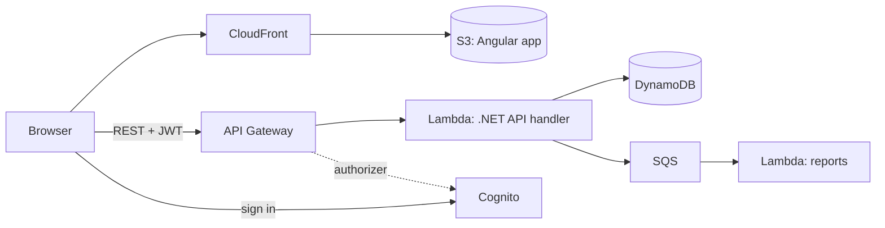

# 🥗 Green & Tasty Restaurants

A restaurant booking web application. Guests find a restaurant, book a table, invite friends and order their dishes in advance, so the food is ready when the group arrives.

I built this project during **EPAM IT Marathon 6.0**.

**Live demo:** https://d2js4d9qmfl4c8.cloudfront.net/


---

## Contents

- [Features](#features)
- [Tech stack](#tech-stack)
- [Architecture](#architecture)
- [Deployment](#deployment)
- [My marathon task: Group Pre-Order](#my-marathon-task-group-pre-order)
- [Bug fixes](#bug-fixes)
- [Repository layout](#repository-layout)
- [Development](#development)

---

## Features

| Role         | What the user can do                                                                                                                                 |
| ------------ | ---------------------------------------------------------------------------------------------------------------------------------------------------- |
| **Customer** | Browse locations and the menu, book a table, edit or cancel it. Make a pre-order, invite guests with a link, see the group pre-order, leave feedback |
| **Guest**    | Open the invite link, enter a name, add dishes to a personal cart and submit it to the group                                                         |
| **Waiter**   | See the reservations of the location, make a reservation for a visitor, make pre-orders for visitors                                                 |
| **Admin**    | See reports for locations and waiters                                                                                                                |

---

## Tech stack

| Area               | Technologies                                                                                        |
| ------------------ | --------------------------------------------------------------------------------------------------- |
| **Frontend**       | Angular 22 (standalone components, signals), TypeScript, SCSS, RxJS, Karma + Jasmine                |
| **Backend**        | .NET 10, C#, AWS Lambda (API handler, report handlers), xUnit + Moq                                 |
| **Data and auth**  | Amazon DynamoDB, Amazon Cognito                                                                     |
| **API**            | Amazon API Gateway (REST)                                                                           |
| **Infrastructure** | Terraform (S3, CloudFront, Cognito, SQS, EventBridge, IAM), AWS Syndicate for the backend resources |
| **Hosting**        | Amazon S3 static website behind Amazon CloudFront                                                   |

---

## Architecture



The repository is a monorepo with three deployment tracks:

1. **Terraform** creates the shared AWS infrastructure.
2. **AWS Syndicate** deploys the Lambda functions, API Gateway and DynamoDB tables.
3. The **Angular** production build goes to the S3 bucket behind CloudFront.

---

## Deployment

The application is **deployed and running on AWS**: https://d2js4d9qmfl4c8.cloudfront.net/

- I deployed the infrastructure, the backend and the frontend in the order above.
- The DynamoDB tables are **filled with data**, so the demo works right away.

The step-by-step guide (prerequisites, commands, clean-up) is in [`homework-deployment.md`](homework-deployment.md).

> 🔐 No credentials, account IDs or `.tfvars` files are in this repository. Each user supplies them through a local AWS CLI profile.

---

## My marathon task: Group Pre-Order

My task was to implement the **Group Pre-Order modal** for the reservation owner. I also added a **bonus for an on-time group pre-order** and my own design, where avatar circles show which guests ordered and which did not.

### What the owner sees

- A **Group Pre-Order** button on the reservation card (group reservations with 2 or more guests). To save space on the card, _Cancel_ became a trash icon.
- **Seats as circles.** The owner, the guests who ordered (green, with initials) and empty seats (dashed, "Waiting"). A large group gets a horizontal slider.
- **The owner's own pre-order.** The owner can change quantities, remove dishes, or open the menu with "Add my dishes".
- **The guests' pre-orders.** Each guest's dishes and subtotal, with _Expand all_ / _Collapse all_.
- **Grand total** with a breakdown: own order, guests' orders and the group discount.
- **Actions:**
  - _Copy pre-order link_. The owner sends the link to remind the guests.
  - _Remove guest_, with a confirmation.
  - _Submit Pre-Order_. If some seats are empty, a confirmation tells the owner which bonus will not apply.
  - After the submit, the modal shows **"Sent to Restaurant"**.

### Group bonus

The backend calculates the bonus from the time of the last pre-order:

| When all seats ordered                  | Bonus                               |
| --------------------------------------- | ----------------------------------- |
| At least 24 h before the reservation    | **10% discount** on the group total |
| Less than 24 h, but at least 2 h before | **Free dessert** for the table      |
| Later, or not all seats ordered         | No bonus                            |

While the group is still ordering, the modal shows the bonus that the group can still get. It also shows how many guests must order, a progress bar and the time left until the deadline.

### What changed for this feature

- **Backend:** a bonus calculator with tests for the exact 24 h / 2 h limits, order timestamps, `orderedCount` and `bonus` in the group status, and the owner in the sessions list.
- **Backend:** the group submit works with any first pre-order and never adds the owner's dishes twice.
- **Frontend:** the modal, a confirm dialog, the group orders service, view helpers and the reservation card update.
- **Process:** every step went through an AI agent pipeline (plan → tests first → code → independent review). The records are in [`.claude/work/_archive/`](.claude/work/_archive/).

---

## Bug fixes

Bugs that I found and fixed during the marathon:

| Area            | Fix                                                                                                                                                                         |
| --------------- | --------------------------------------------------------------------------------------------------------------------------------------------------------------------------- |
| Group bonus     | The bonus existed only in the owner's modal. Now the group submit stores the bonus on the order.                                                                            |
| Reservations    | A change of the guest count did not create or close the group. Now an edit of the reservation keeps the group in sync.                                                      |
| Guest pre-order | A guest could change the pre-order after the submit. Now the submitted guest pre-order is final.                                                                            |
| Group modal     | Fixed the modal layout on narrow screens.                                                                                                                                   |
| Auth            | The owner's requests to `/guest/groups/...` got **401**, because the token interceptor skipped every `/guest/` URL. Now the owner routes send the sign-in token.            |
| Group sessions  | `DELETE` of a guest session did not follow the API contract. Now only the owner can remove a guest, the owner session stays, and the response returns the remaining guests. |
| API Gateway     | Fixed a wrong path for the group sessions endpoint.                                                                                                                         |
| Pre-order flow  | The pre-order banner showed the table UUID instead of the table number. "Add dish" in the cart did not open the menu in pre-order mode.                                     |
| Cart            | A cancelled reservation left its pre-order in the cart. Now the reservation cancel also cancels the pre-order. The cart shows the address and time instead of an order ID.  |
| Cart            | I redesigned the cart (Figma screens C1/C2). A group owner saves the own order instead of submitting it alone, so the group pre-order has no duplicates.                    |
| Reservations    | The owner seat in the group pre-order tracker had a solid green ring before the owner made an order. It now shows a gray dashed ring until the owner orders.                 |
| Main page       | `app-dish-modal` was part of the flex flow and created an extra gap. The modal host now stays out of that flow.                                                            |
| Group modal     | `app-confirm-dialog` added an extra flex gap in the group pre-order modal. The host now uses `display: contents`, and the overlay stays visible.                              |
| Reservations    | Reservation times were mixed between 12-hour and 24-hour formats. Reservation cards and confirmation now use a 24-hour format.                                              |
| Guest pre-order | Re-opening a full guest invite showed a generic retry error and flashed the name modal before invite loading. The page now shows a relevant limit message and a loader first. |
| Menu and dishes | A fallback image for dishes with no image. Aligned quantity buttons. Menu block styles. The hover cursor on dish cards.                                                     |
| Reservations    | Styles of the edit reservation confirmation.                                                                                                                                |
| Config          | Fixed the backend environment link in the frontend configuration.                                                                                                           |
| Tests           | Fixed or replaced old frontend specs that no longer matched the app. The suite now has 0 failed tests.                                                                      |

Known open items are in [`docs/tech-debt.md`](docs/tech-debt.md), [`backend/.../docs/tech-debt.md`](backend/restaurant-backend-app/docs/tech-debt.md) and [`frontend/.../docs/tech-debt.md`](frontend/restaurant-frontend-app/docs/tech-debt.md).

---

## Repository layout

```
├── frontend/restaurant-frontend-app   Angular SPA
├── backend/restaurant-backend-app     .NET Lambda functions, tests, API docs
├── infra/terraform                    shared AWS infrastructure
├── docs/                              tech debt
├── homework-deployment.md                 deployment guide
└── .claude/                           AI agent rules, skills and task records
```

API contract: [`backend/restaurant-backend-app/docs/ApiRoutes.md`](backend/restaurant-backend-app/docs/ApiRoutes.md).

---

## Development

**Frontend** (Node.js 22 or 24):

```bash
cd frontend/restaurant-frontend-app
npm ci
npm start
```

The dev server runs on http://localhost:4200 and uses the development API.

**Backend** (.NET 10 SDK):

```bash
cd backend/restaurant-backend-app
dotnet build restaurant-backend-app.sln
dotnet test Tests/APIHandler.Tests.csproj
```

The backend runs only on AWS. There is no local host.
